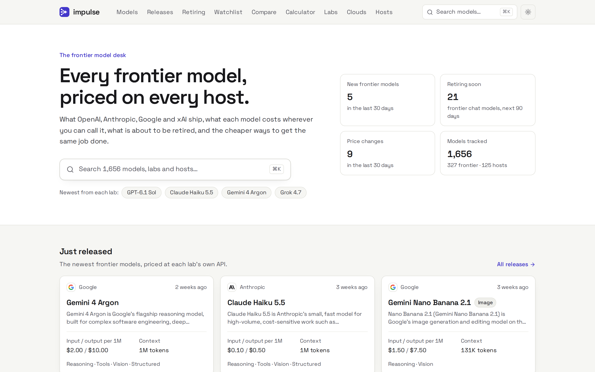
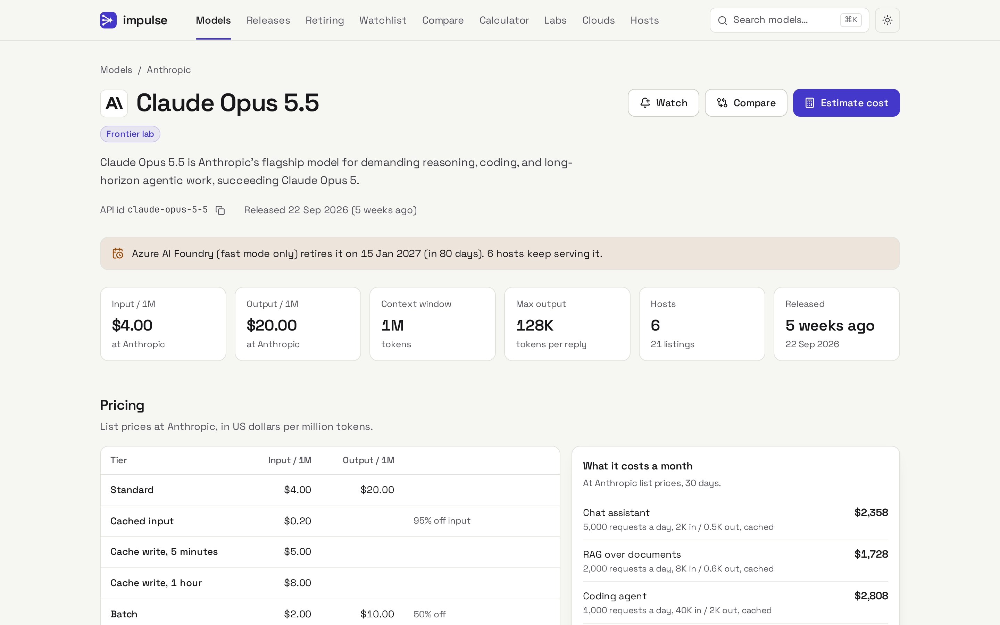
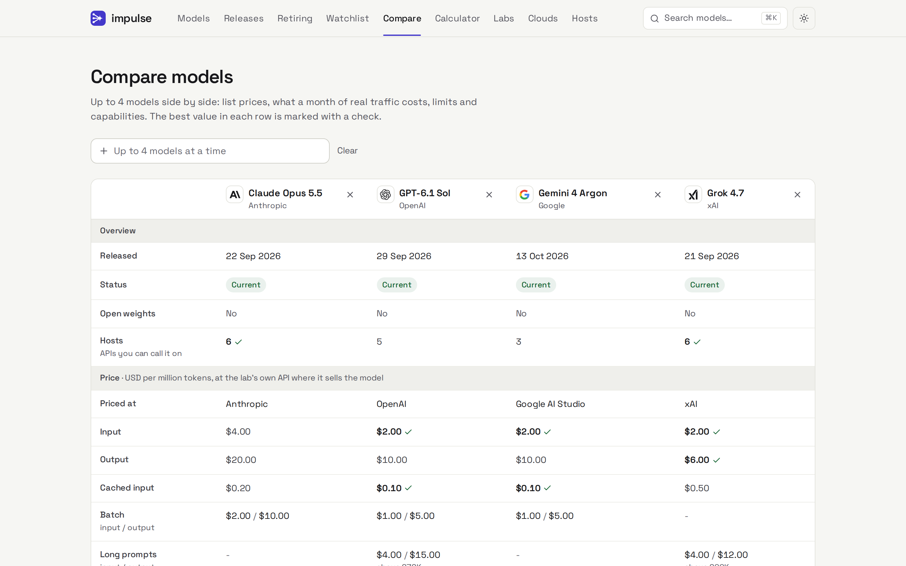
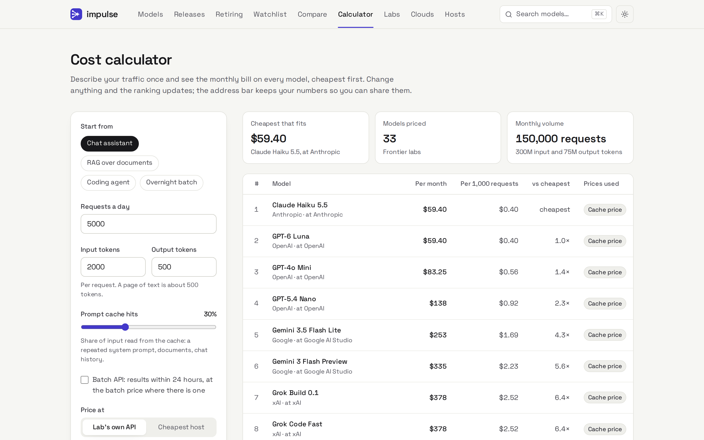
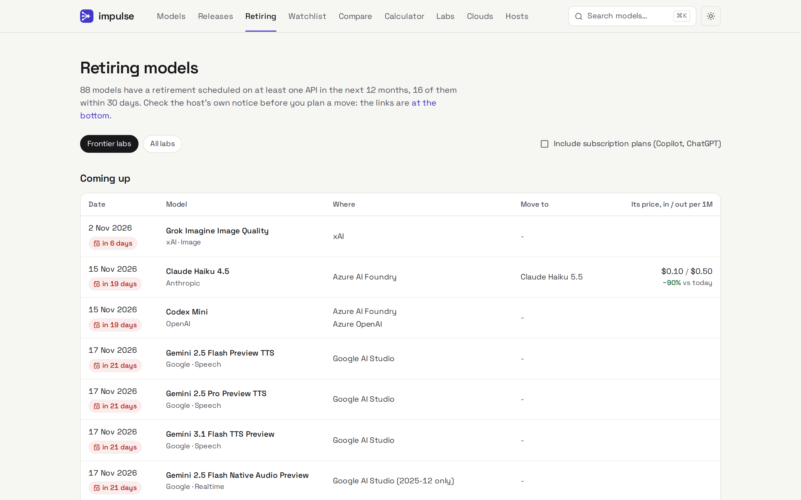
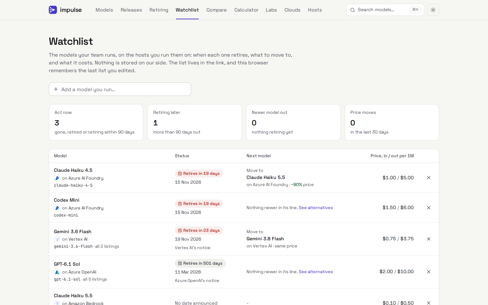
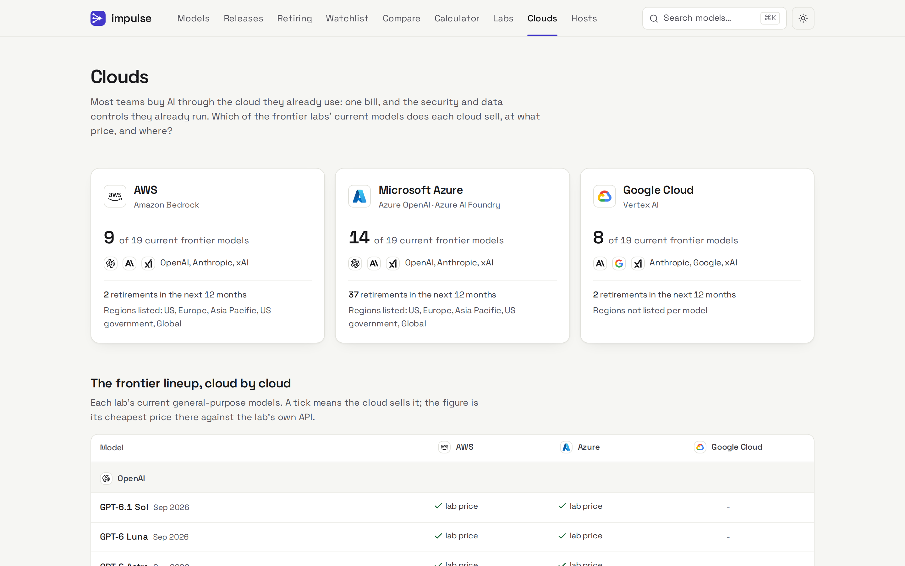

# Impulse - web

**The frontier model desk.** What OpenAI, Anthropic, Google and xAI ship, what each model
costs on every host, what is about to be retired, and the cheaper ways to get the same job
done. Open-weight and other labs are covered too.



This is the **frontend** - one of two repos:

| Repo | Role |
|---|---|
| [`impulse-api`](https://github.com/viveshy/impulse-api) | Backend - a read-only HTTP API (`app/`) plus the catalog **sync** (`sync/`) that builds its SQLite database from LiteLLM, OpenRouter, Hugging Face and open leaderboards |
| **impulse** (this repo) | Next.js web app that reads the API |

## Screenshots

| Model page | Compare |
|---|---|
|  |  |
| **Cost calculator** | **Retiring models** |
|  |  |
| **Watchlist** | **Clouds** |
|  |  |

## Features

- **Home** - the newest frontier releases, each lab's current lineup, what is retiring in
  the next 90 days and the price changes of the last 30.
- **Model pages** (`/models/<lab>/<model>`) - the headline price with cache, batch and
  long-context tiers, every host's price against it, capabilities, cheaper alternatives in
  four groups, the model's line (what replaced it), retirement dates and code to call it.
- **Models** - a filterable table (tier, lab, kind, search, sort), all in the URL.
- **Releases** - month by month, with an RSS feed at `/releases/feed.xml`.
- **Retiring** - every announced retirement in the next 12 months and what to move to,
  with the successor's price against today's.
- **Watchlist** (`/watchlist`) - list the models your team runs on the hosts it runs them on
  and get one page of what to act on: retirements, what to move to, newer models and price
  moves. No accounts: the list lives in the link, with a calendar feed
  (`/watchlist/calendar.ics`) and an RSS feed (`/watchlist/feed.xml`) for alerts.
- **Clouds** (`/clouds`) - which of the frontier labs' current models AWS, Microsoft Azure
  and Google Cloud sell, at what price against the lab's own API, in which regions, and
  what each retires next, with a region filter for teams whose data has to stay put.
- **Compare** - up to four models side by side, including what a month of real traffic
  costs on each.
- **Cost calculator** - describe your traffic once (requests, tokens, cache hits, batch)
  and rank every model by monthly bill, at the lab's price or the cheapest host. The URL
  keeps the numbers, so a result can be shared.
- **Labs and hosts** - who makes what, and what each host charges against the lab.
- **⌘K search** across models, labs, hosts and pages.
- **Site stats** (`/stats`) - a public visitor counter. No cookies and no stored IP
  addresses: the API keeps a hash salted with a key that changes daily and is then deleted.
- Light theme by default, dark on request.

## Getting started

Needs the API running (see [`impulse-api`](https://github.com/viveshy/impulse-api)). Then:

```bash
npm install
IMPULSE_API_URL=http://localhost:8080 npm run dev   # http://localhost:3000
```

`IMPULSE_API_URL` points at the backend (defaults to `http://localhost:8080`). There is
**no bundled data** - if the API is unreachable, the app says so rather than showing stale
content.

```bash
npm test        # unit tests (Vitest)
npm run lint
npm run build   # production build; the API must be reachable
```

## How data flows

Pages are server components that read the catalog through the `DataSource` interface
(`src/lib/data/`), cached in memory for five minutes and refreshed with ISR. The catalog
layer (`src/lib/catalog/`) folds every host's row for a model into one canonical model with
a headline price, so a model has one page and every view agrees on what it costs. The
browser only calls two same-origin routes: `/api/search-index` for ⌘K and `/api/v` for the
visitor beacon.

## Project structure

```
src/
  app/            routes, plus api/ route handlers and redirects for old /app links
  components/     site chrome, ui primitives, and one folder per page
  lib/
    catalog/      canonical index: grouping, labs, hosts, lineage, prices, alternatives
    data/         DataSource interface + HttpDataSource
    domain/       API-facing types and capability labels
```

## Stack

Next.js 16 (App Router) · React 19 · TypeScript · Tailwind v4 (CSS-first `@theme`) ·
cmdk · lucide-react · Vitest. Font: Space Grotesk.

See [`AGENTS.md`](./AGENTS.md) for architecture and contribution conventions.

## Contributing

Issues and PRs welcome. Before submitting, run `npm test`, `npm run lint` and
`npm run build` (with the API reachable). Keep the design restrained - see the philosophy in
`AGENTS.md`.

## Acknowledgements

Catalog data comes from open sources - [LiteLLM](https://github.com/BerriAI/litellm),
[OpenRouter](https://openrouter.ai), the [Hugging Face Hub](https://huggingface.co), and
open leaderboards ([Aider](https://aider.chat/docs/leaderboards/), the HF Open LLM
Leaderboard). No paid data providers.

## License

Released under the MIT License - see [`LICENSE`](./LICENSE).
