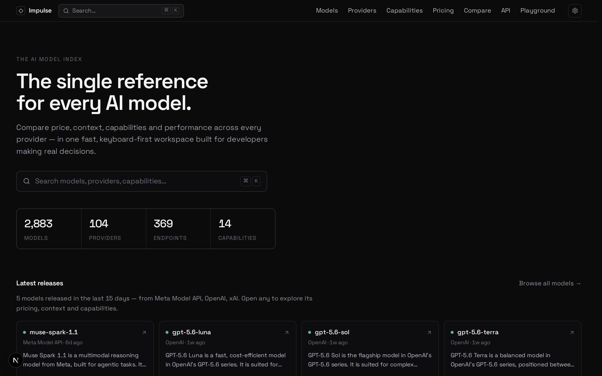
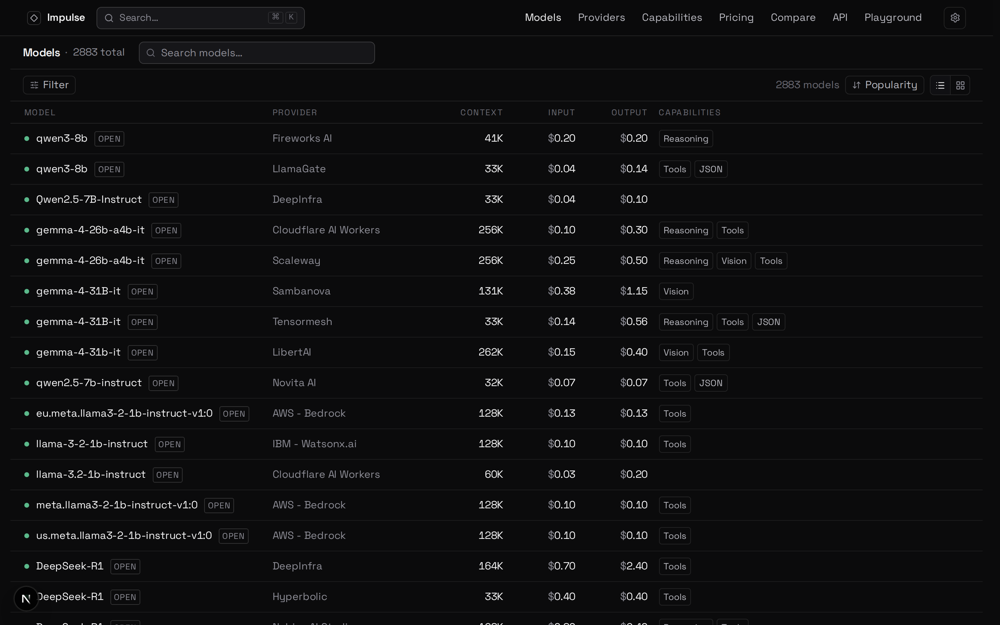
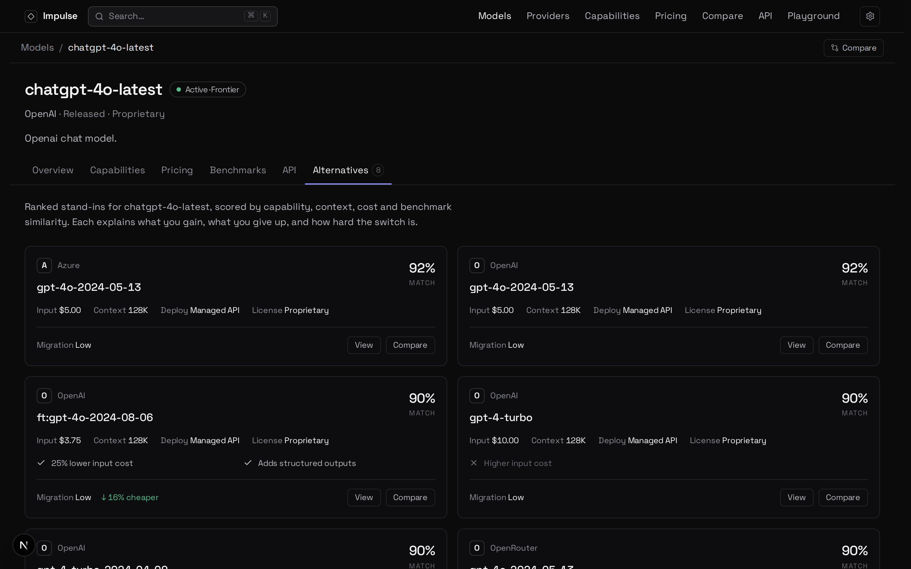
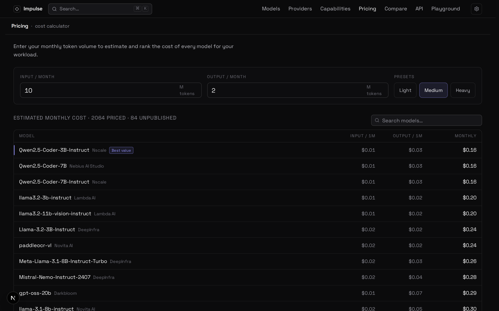

# Impulse - web

**The single reference for every AI model.** A fast, keyboard-first explorer for AI
providers and models - compare price, context, capabilities, benchmarks, and self-host
requirements across every provider in one place, and find the **open-weight alternative**
to any model.



Impulse is a developer tool: dense, precise, and quiet. This is the **frontend** - one of
two repos:

| Repo | Role |
|---|---|
| [`impulse-api`](https://github.com/viveshy/impulse-api) | Backend - a read-only HTTP API (`app/`) plus the catalog **sync** (`sync/`) that builds its SQLite database from LiteLLM + OpenRouter + Hugging Face + open leaderboards |
| **impulse** (this repo) | Next.js web app that reads the API |

## Screenshots

| Models explorer | Alternatives |
|---|---|
|  |  |
| **Pricing calculator** | |
|  | |

## Features

- **Models explorer** - dense, sortable, filterable list/grid with capabilities, pricing,
  and context at a glance. Filters are URL-synced and shareable.
- **Model detail** - pricing, context, capability checklist, benchmarks, endpoints, and a
  two-tier **alternatives** view (open-weight first, then cheaper) scored by capability,
  context, cost, and benchmark similarity.
- **Provider pages** - endpoints, regions, auth, SDK install commands, a scoped model list.
- **Pricing calculator** - enter monthly token volume and rank models by estimated cost.
- **Compare** - up to four models side by side with a capability matrix.
- **Capability explorer** and a **⌘K command palette** for keyboard-first navigation.
- **In-page search** on models, providers, pricing, and the API explorer.

## Getting started

Needs the API running (see [`impulse-api`](https://github.com/viveshy/impulse-api)). Then:

```bash
npm install
IMPULSE_API_URL=http://localhost:8080 npm run dev   # http://localhost:3000
```

`IMPULSE_API_URL` points at the backend (defaults to `http://localhost:8080`). There is
**no bundled data** - if the API is unreachable, the app says so rather than showing stale
content.

```bash
npm run build   # type-check + lint + production build (the API must be reachable)
npm run lint
```

## How data flows

The UI depends only on the `DataSource` interface (`src/lib/data/`). Its single
implementation, `HttpDataSource`, reads the API. Client components never call it directly -
they fetch same-origin route handlers (`src/app/api/*`) that run the data source on the
server, so the backend URL and full-catalog paging stay server-side. Filter/sort/facet
logic is one shared module (`src/lib/data/query.ts`). Models and providers are addressed by
an opaque, stable **GUID** - internal identifiers never appear in a URL.

## Project structure

```
src/
  app/            routes - `/` (marketing) and `/app/*` (the tool); `api/*` route handlers
  components/     layout (TopNav, Topbar, CommandMenu), models, providers, pricing, api, common
  lib/
    domain/       types, Zod schemas, capability catalog (source of truth for shape)
    data/         DataSource interface + HttpDataSource + shared query logic
    query/        TanStack Query hooks
```

## Stack

Next.js 16 (App Router) · React 19 · TypeScript · Tailwind v4 (CSS-first `@theme`) ·
TanStack Query · cmdk · framer-motion · zod. Font: Space Grotesk.

See [`AGENTS.md`](./AGENTS.md) for architecture and contribution conventions.

## Contributing

Issues and PRs welcome. Before submitting, run `npm run lint` and `npm run build` (with the
API reachable). Keep the design restrained - see the philosophy in `AGENTS.md`.

## Acknowledgements

Catalog data comes from open sources - [LiteLLM](https://github.com/BerriAI/litellm),
[OpenRouter](https://openrouter.ai), the [Hugging Face Hub](https://huggingface.co), and
open leaderboards ([Aider](https://aider.chat/docs/leaderboards/), the HF Open LLM
Leaderboard). No paid data providers.

## License

Released under the MIT License - see [`LICENSE`](./LICENSE).
